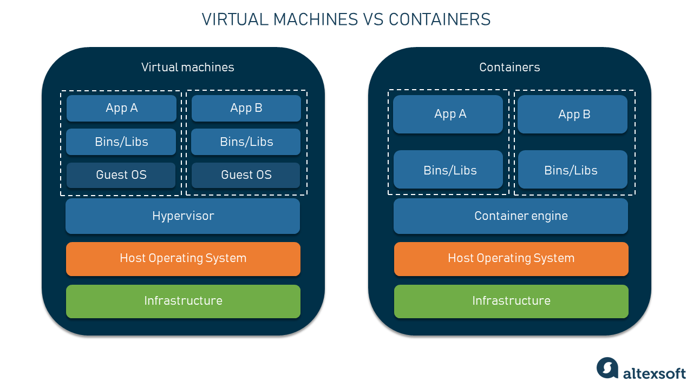
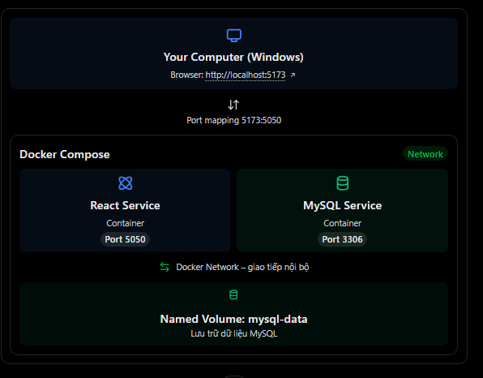
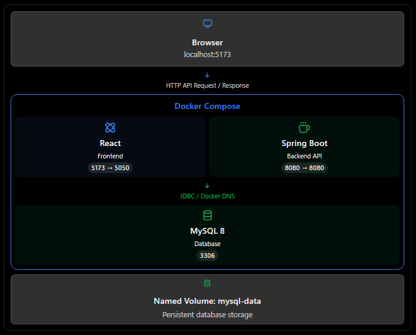

## Docker = Isolated Process


Để cô lập container docker sử dụng Linux ernel:

- **Namespace**: cô lập network, process, filesystem của các app

- **Control groups (cgroups)**: giới hạn tài nguyên CPU và RAM

Do cần làm việc với Linux kernel, nên docker desktop sẽ cung cấp máy ảo linux gọn nhẹ cho Window (WSL2) và Mac (Linux VM)


## Kiến trúc Docker

Docker theo mô hinh **Client - Server**


Gồm 3 phần chính

1. **Docker CLI:** 
    - nơi tương tác với docker thông qua command line, gửi yêu cầu cho Docker Host thông qua REST API

2. **Docker Host:** môi trường chạy Docker Daemon (dockerd) và quản lí Docker Object:
    - Docker Daemon (dockerd): tiếp nhận yêu cầu
        - Một background processing chạy với quyền ``root`` bên trong hệ thống. 
        - Do quyền ``root`` quá nguy hiểm nên dẫn dến sự ra đời của ``Podman``
    - Images: bản mẫu tạo Containers 
    - Containers: môi trường chạy ứng dụng
    - Network: kết nối giữa các Containers
    - Volumes: lưu trữ dữ liệu lâu dài 

3. **Docker Register:** nơi lưu trữ và phân phối Docker Images
    - Docker Hub
    - Amazon ECR
    - GitHub Container Registry


## Dockerfile - Docker Image - Docker Compose

| Dockerfile    | Docker Image | Docker Compose |
| -------- | -------- | -------- |
| Bản hướng dẫn để đóng gói ứng dụng | Sản phẩm tạo ra từ Dockerfile | Công cụ quản lí nhiều Container chạy cùng lúc |


### 1. Dockerfile

```FROM:``` chọn image nền (node, python, ubuntu)

``WORKDIR:`` thư mục làm việc chính trong Contianer. Mọi lệnh ``RUN``, ``CMD``, ``COPY`` đều nằm trong thư mục này

``RUN:`` thực thi các lệnh terminal trong quá trình build image (cài đặt packeage/dependencies)

``EXPOSE:`` khai báo port cho Container (port này vẫn chưa publish ra bên ngoài)

``CMD:`` lệnh mặc định thực thi khi Container bắt đầu chạy, chỉ 1 lênh ``CMD`` trong dockerfile

``COPY / ADD:`` sao chép tệp hoặc thư mục từ máy host vào image

``ENV:`` khai báo môi trường


#### 1.1 Dockerfile với React

Tạo dự án React

```
npm create vite@latest my-react-app -- --template react
```

Tạo Dockerfile

```java

// 1. chọn node v22 image
FROM node:22-alpine

// 2. thư mục làm việc trong container
WORKDIR /app

// 3. copy các file có tên bắt đầu bằng package và kết thúc bằng .json vào thư mục /app
COPY package*.json ./

// 4. Cài đặt dependencies
RUN npm install

// 5. Copy source code
// '.' thứ nhất: thư mục build context máy host
// '.' thứ hai: thư mục trong docker image (/app)
COPY . .

// 6. expose port container
EXPOSE 5050


// 7. Chạy Vite server
// Exec Form không thông qua Shell

// "--" là phần cách     
// npm run <script> -- <agrument>
// trước "--": tham số cho npm
// sau "--": tham số cho chương trình sau khi chạy npm

CMD ["npm", "run", "dev", "--", "--host", "0.0.0.0", "--port", "5050"]

```

Hiểu thêm về lệnh ``CMD``

Lệnh này chạy sau khi đã tạo container

```
CMD ["npm", "run", "dev", "--", "--host", "0.0.0.0"]
```


Build Docker Image

```
docker build -t my-react-app .
```

- ``docker build``: build docker image từ dockerfile

- ``-t my-react-app``: tag tên docker image

- ``.``: build ở thư mục hiện tại

Kiểm tra images

```
docker images
```

Run Docker Container 

```
docker run -d -p 5173:5050 --name react-container my-react-app
```
- ``docker run``: khởi tạo container

- ``-d``: Detached mode - chạy container ở chế đồ nền

- ``-p``: Publish port - ánh xạ port host và container

- ``5173:5050``: host port (port trên máy tính) là 5173 và container port 5050

- ``react-container``: tên container sau khi build

- ``my-react-app``: tên image để build container


### 2 Docker Compose

Giả sử một ứng dụng

1. SpringBoot: Backend API
2. MySQL
3. Redis

Thay vi chạy từng lệnh docker

```
docker run -d --name mysql ...
docker run -d --name redis ...
docker run -d --name springboot ...
```

Nếu không có docker compose phải chạy từng container tự cấu hình port, networkm environment và kết nối giữa các container

### 2.1 Kiến trúc docker compose


1. ``docker-compose``: file cấu hình

2. ``Networks``: kết nối container với nhau

3. ``Volumes``: lưu trữu dữ liệu bền vững

4. ``Service``: định nghĩa các service container cần chạy


### 2.2 Docker compose với react

Tạo file ``compose.yaml`` trong thư mục react

```
services:
  react-app-services:
    build:
       context: .
       dockerfile: Dockerfile
    container_name: react-app-container
    ports:
      - "5173:5050"
	
```

Trong đó:

- ``services``: khai báo service

- ``react-app-services``: tên service

- ``build``: yêu cầu build image

- ``context``: lấy thư mục hiện tại làm build context

- ``dockerfile``: đường dẫn dockerfile

- ``container_name``: tên container

- ``ports``: mapping port


Chạy docker compose

```
docker compose -p react-app-service up -d --build
```

Trong đó:

- ``docker compose``: sử dụng docker để quản lí service


- ``-p react-app-service``: đặt tên seriice

- ``up``: khởi tạo container

- ``-d``: chạy container ở chế độ detached

- ``--build``: build image trước khi khởi chạy container


### 2.3 Docker compose với react + mySQL



```
services:
  react-app-services:
    image: react-app-compose-image
    build:
       context: .
       dockerfile: Dockerfile
    container_name: react-app-compose-container
    ports:
      - "5173:5050"
    depends_on: 
      - mysql

  mysql:
    image: mysql:8.0
    container_name: mysql-container
    environment:
      MYSQL_ROOT_PASSWORD: 123
      MYSQL_DATABASE: react_db
    ports:
      - "3306:3306"
    volumes:
      - mysql-data:/var/lib/mysql

volumes:
  mysql-data:
```


### 2.4 Docker compose với React + Springboot + MySQL



Cấu trúc thư mục

```
docker-compose-project/
│
├── frontend/
│
├── backend/
│
└── compose.yaml
```

Luồng request


```
Browser
  │
  │ 1. GET / hoặc React UI
  ▼
React (Vite)
  │
  │ 2. HTTP Request: GET /api/users
  ▼
Spring Boot (REST API)
  │
  │ 3. JDBC Query
  ▼
MySQL
  │
  │ 4. Return data
  ▼
Spring Boot
  │
  │ 5. JSON Response
  ▼
React → Browser
```


#### 2.4. Docker Compose tự tạo Network như thế nào?